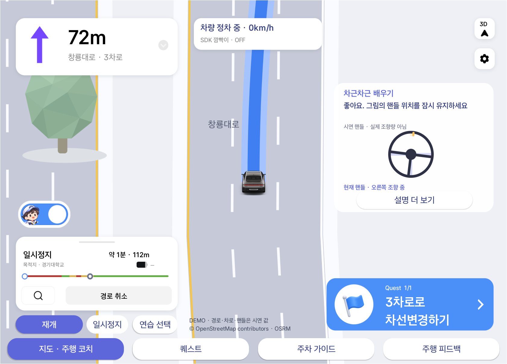
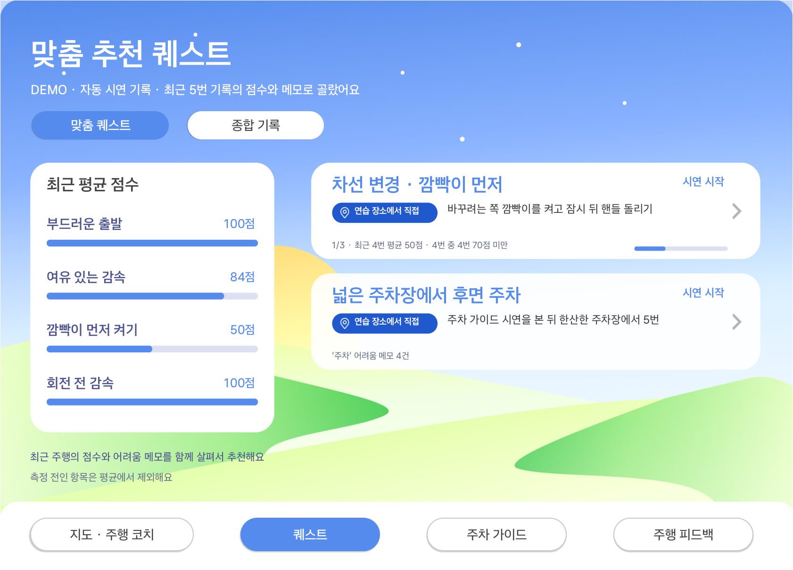
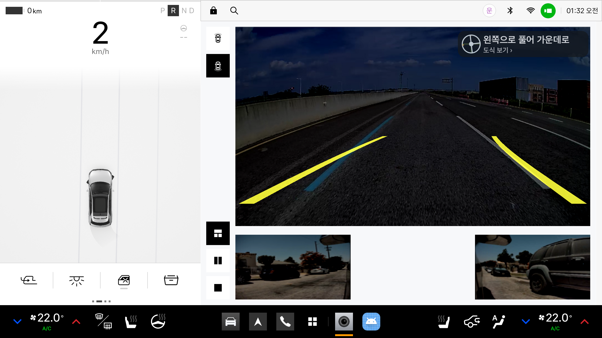
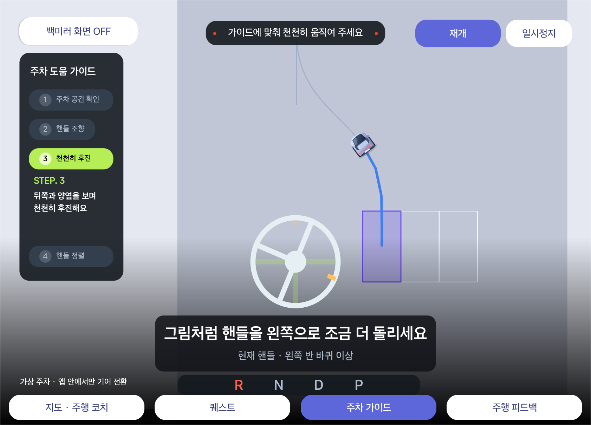
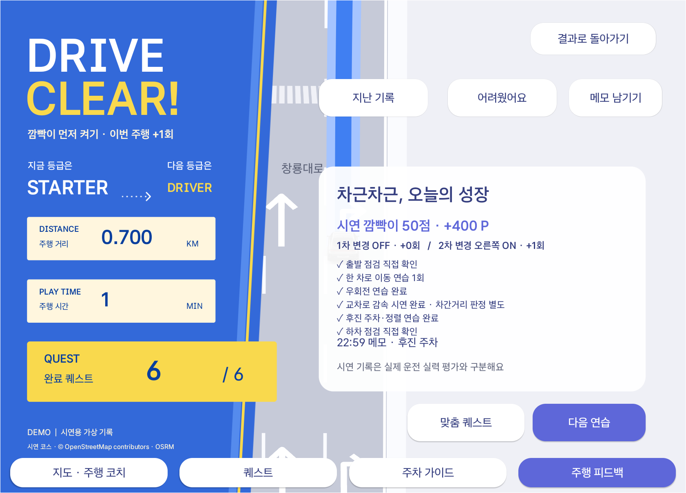
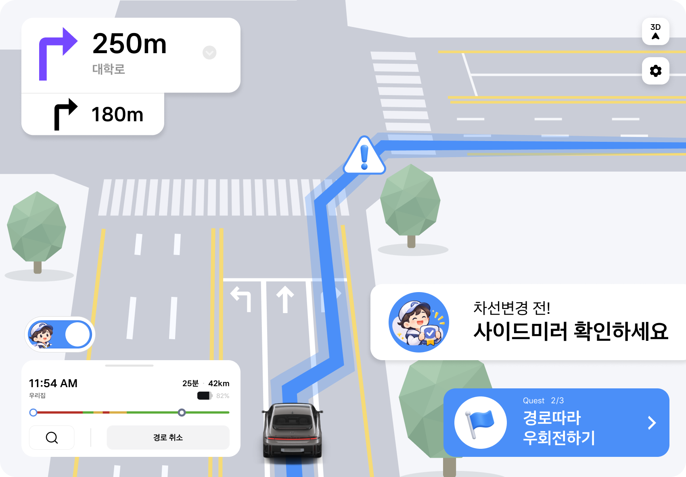
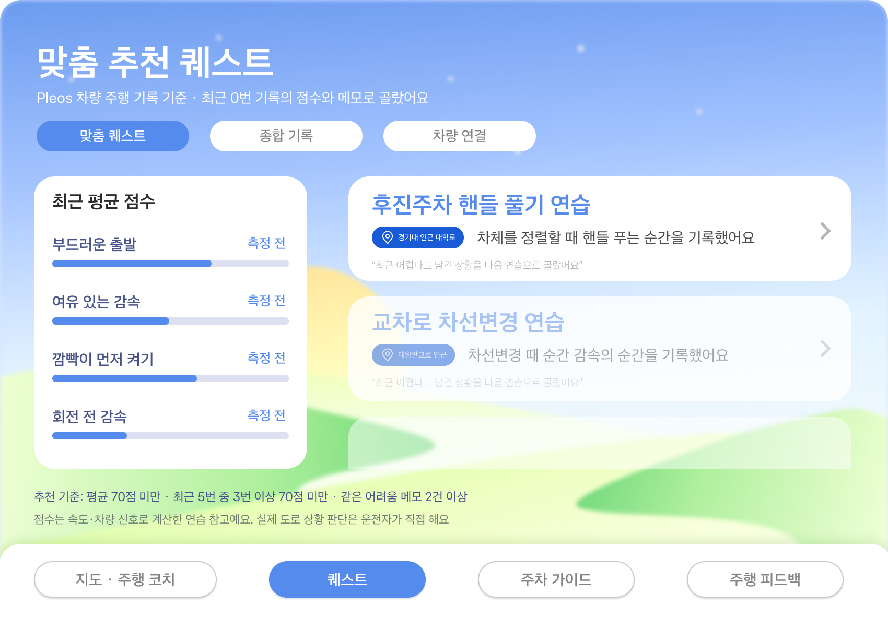
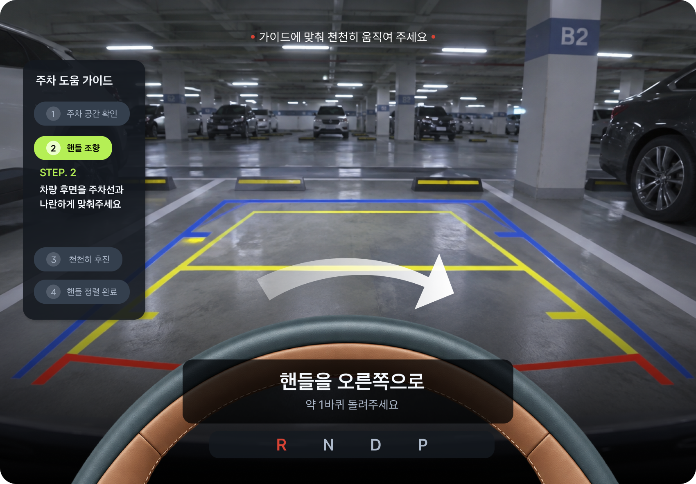
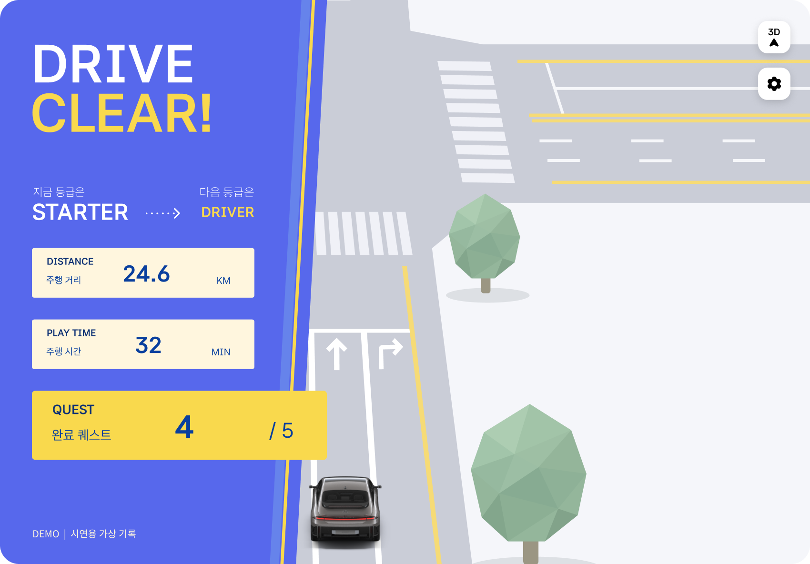

# 차근차근 2026 현대차 공모전

차로를 바꿀 때 언제 깜빡이를 켜고, 우회전이나 후진 주차를 할 때 핸들을 얼마나 돌려야 할지 연습하는 차량용 Android 앱입니다. 주행을 마치면 퀘스트 결과와 피드백을 확인할 수 있습니다.

## 제출용 APK

팀명: **코치꼬치** · 앱명: **차근차근**

- 저장소 내 APK 경로: [apk/코치꼬치_차근차근_release.apk](apk/코치꼬치_차근차근_release.apk)

- [차근차근 0.3.0 release APK 다운로드](https://raw.githubusercontent.com/yooniseo/pleos-app-challenge/v0.3.0/apk/%EC%BD%94%EC%B9%98%EA%BC%AC%EC%B9%98_%EC%B0%A8%EA%B7%BC%EC%B0%A8%EA%B7%BC_release.apk)
- [GitHub Release · 설치 파일과 검증 결과](https://github.com/yooniseo/pleos-app-challenge/releases/tag/v0.3.0)
- [제출 버전 소스 코드](app/src) · [APK SHA-256 확인](https://github.com/yooniseo/pleos-app-challenge/releases/download/v0.3.0/SHA256SUMS.txt)

저장소에는 제출 규격의 한글 파일명으로, GitHub Release에는 동일한 APK를 `coachkkochi_chageunchageun_release.apk`라는 영문 파일명으로 제공합니다.

별도 키로 서명한 release APK이며 디버깅은 비활성화되어 있습니다. Pleos 에뮬레이터에서 평가하는 제출 버전입니다.

## 실행 화면

Pleos 에뮬레이터에서 실행한 앱입니다. 주행·주차 장면과 결과는 시뮬레이션 데이터이며, 화면이 잘 보이도록 앱 영역만 잘랐습니다.

| 주행 코치 | 맞춤 퀘스트 |
| --- | --- |
|  |  |
| 차로 변경에 맞춰 핸들 조작을 안내합니다. | 시연 기록의 점수와 메모로 다음 연습을 추천합니다. |
| **주차 연습** | **주행 피드백** |
| <br> |  |
| Pleos 에뮬레이터의 후방 카메라 예제 영상 위에 핸들 조작 안내를 표시합니다. 실제 차량에서 촬영한 영상은 아닙니다. 아래 도식은 가상 주차장을 가정했을 때의 단계별 안내 예시입니다. | 저장한 시연의 거리·시간·완료 퀘스트를 확인합니다. |

## 디자인 컨셉

앱의 화면 구성과 사용 흐름을 설명하기 위한 자료로, 실제 실행 화면과는 차이가 있습니다. 시안의 퀘스트 종류·수치·차량 연결 표시는 구현 상태를 나타내지 않습니다. 특히 주차 화면의 실사 배경과 주차선은 컨셉 표현이며, 위 실행 화면은 가상 주차장을 사용합니다.

| 경로 내비게이션 | 맞춤 추천 퀘스트 |
| --- | --- |
|  |  |
| **주차 가이드** | **퀘스트 완료** |
|  |  |

## 테스트 환경과 설치

| 항목 | 검증 환경 |
| --- | --- |
| Pleos Connect | **2.1.0**, 빌드 `RELEASE.release_connect_v2.1.0 test-keys` |
| 운영체제·CPU | Android 14 / API 34 / x86_64 |
| Android Emulator | 37.2.13.0 |
| 화면 규격 | **2560 × 1440px, 160dpi(mdpi), 가로 화면** |
| 가상 기기 | Pleos Connect 기기 프로필, RAM 4GB, CPU 4코어, GPU host |
| 개발 환경 | Windows / JDK 17 / Android SDK 34 / Build Tools 34.0.0 |
| 빌드 도구 | Kotlin 1.9.25 / AGP 8.1.4 / Gradle 8.1.1 |
| 앱 | `com.hmgchallenge.pleosstarter` / 0.3.0 (versionCode 3) / minSdk 28 |

### APK 설치

1. Pleos Connect 2.1.0 가상 기기를 부팅합니다. 기존 debug 앱과 release 앱은 서명이 다르므로, 개발용 기기의 데이터를 보존하려면 새 AVD를 사용하세요.
2. 위 release APK를 내려받습니다. Android SDK의 `adb devices`로 에뮬레이터 번호를 확인합니다.
3. 다운로드 폴더에서 아래 PowerShell 명령을 실행합니다. `$serial`은 실제 기기 번호에 맞게 수정합니다.

```powershell
$adb = "$env:LOCALAPPDATA\Android\Sdk\platform-tools\adb.exe"
$serial = "emulator-5554"
$androidUser = (& $adb -s $serial shell am get-current-user).Trim()

& $adb -s $serial install -r --user $androidUser .\코치꼬치_차근차근_release.apk
& $adb -s $serial shell pm grant --user $androidUser com.hmgchallenge.pleosstarter android.car.permission.CAR_SPEED
& $adb -s $serial shell appops set --user $androidUser com.hmgchallenge.pleosstarter SYSTEM_ALERT_WINDOW allow
& $adb -s $serial shell am start --user $androidUser -W -n com.hmgchallenge.pleosstarter/.app.ChageunActivity
```

`CAR_SPEED`는 차량 속도 수신, `SYSTEM_ALERT_WINDOW`는 시스템 후방 카메라 위의 주차 안내 카드에 사용합니다. 다른 Pleos 차량·내비게이션·음성 서비스 권한은 앱 매니페스트에 선언되어 있습니다.

기본 자동 시연과 지도에는 계정, 서버 등록, 지도 API 키가 필요하지 않습니다. 지도는 앱에 포함된 OSM/OSRM 데이터를 사용하고 음성 안내는 Pleos의 on-device TTS를 사용합니다. APK를 설치한 뒤 기본 시연에는 외부 인터넷 연결이 필요하지 않습니다.

release에서도 에뮬레이터의 로컬 Virtual Console(`127.0.0.1:8088`)에 시연 신호를 전달합니다. 해당 기능은 Automotive 에뮬레이터 하드웨어에서만 켜지며, 물리 차량에는 콘솔 명령을 보내지 않습니다. **후진 주차 시연에서 백미러 화면을 ON으로 두면 Pleos 예제 후방 영상과 안내 카드를, OFF로 두면 가상 주차장 도식을 확인할 수 있습니다.**

## 실행

설치한 **차근차근** 앱을 실행합니다. 소스에서 실행하려면 Android Studio에서 JDK 17과 Android SDK 34를 설정합니다.

1. 지도에서 **연습 선택**을 엽니다. 차로 변경＋우회전, 차로 변경, 우회전, 후진 주차 중 하나를 고릅니다.
2. **자동 시연 시작**을 누르고 출발 점검을 확인하거나 **점검 기록 없이 시연**을 선택합니다. 페달이나 기어를 조작할 필요는 없습니다. 퀘스트·주차·피드백 탭으로 이동해도 연습은 이어집니다.
3. 연습이 끝나면 거리, 시간, 완료한 퀘스트를 확인합니다. 저장한 결과는 **지난 기록**에서 다시 볼 수 있습니다.

## 시연과 차량 기록

자동 시연의 경로·차로·핸들 움직임은 시나리오 값입니다. 설정에서 **차량 SDK 속도**를 선택하면 경로를 따라가는 속도만 차량 신호를 사용합니다. 두 모드 모두 시연으로 저장합니다. 예를 들어 종합 시연에서는 두 차례 차로 변경 중 한 번만 깜빡이를 켜므로 깜빡이 점수는 50점입니다.

차량 주행 기록은 별도입니다. 차량이 움직이면 기록을 시작하고, 주행 후 정차해 P단으로 바꾸면 마칩니다. 정차 중에는 **주행 피드백 → 차량 주행 기록 마치기**로 직접 종료할 수도 있습니다. 기록은 기기 안의 Room DB에 저장합니다. 지도도 앱에 포함되어 있어 별도 지도 API 키가 필요하지 않습니다.

## 팀 작업

| 기여자 | 맡은 작업 | 원본 작업 |
| --- | --- | --- |
| 김서연 · [@yooniseo](https://github.com/yooniseo) | 주행·주차 코치 화면, 시연 흐름, 기능 통합 | [코치 화면과 공통 시연 세션](https://github.com/yooniseo/pleos-app-challenge/commit/2fe16a7706217fe09f9c21f39d1837adfa9b328d) |
| 신가인 · [@ssggiisgi](https://github.com/ssggiisgi) | 차량 속도·음성 인식 실험, Room 데이터 모델, 주행 분석과 맞춤 퀘스트 추천 | [주행 점수와 맞춤 퀘스트](https://github.com/yooniseo/pleos-app-challenge/commit/a6897f099086b2dc144aa89d84c40488e9429860) |
| 박서연 · [@SYParkky](https://github.com/SYParkky) | 퀘스트 보드, 차량 신호를 이용한 주행 동작 감지, 퀘스트 화면 원형 | [퀘스트 브랜치의 원본 구현](https://github.com/yooniseo/pleos-app-challenge/commit/fba21000320126e698b300abe25863944ed27455) |

## 빌드와 검사

### 서명된 release 빌드

배포된 APK를 설치하는 경우에는 서명 키가 필요하지 않습니다. 소스에서 release APK를 다시 빌드하려면 본인의 서명 키를 만들고, `keystore.properties.example`을 `keystore.properties`로 복사해 키 경로·별칭·비밀번호를 설정합니다. 키와 실제 비밀번호 파일은 Git에서 제외되어 있습니다.

```powershell
.\gradlew.bat :app:assembleRelease :app:testReleaseUnitTest :app:lintRelease
```

생성 위치는 `app/build/outputs/apk/release/app-release.apk`입니다. 본인 키로 다시 빌드한 APK는 배포 APK와 서명이 다릅니다.

### 개발용 debug 빌드

```powershell
.\gradlew.bat :app:assembleDebug :app:assembleDebugAndroidTest :app:testDebugUnitTest :app:lintDebug
```

디버그 APK는 `app/build/outputs/apk/debug/app-debug.apk`에 생성됩니다. [제출용 release 검증 기록](docs/submission-release.md)과 [기존 시연 검사 방법](docs/product-redesign/validation.md)을 참고하세요.
