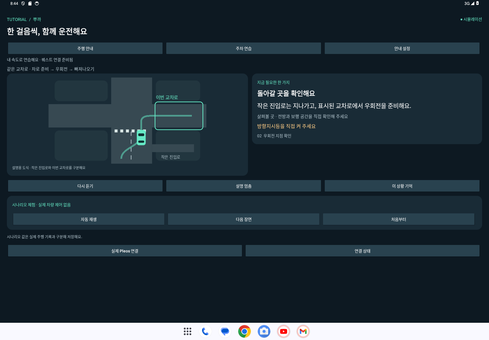
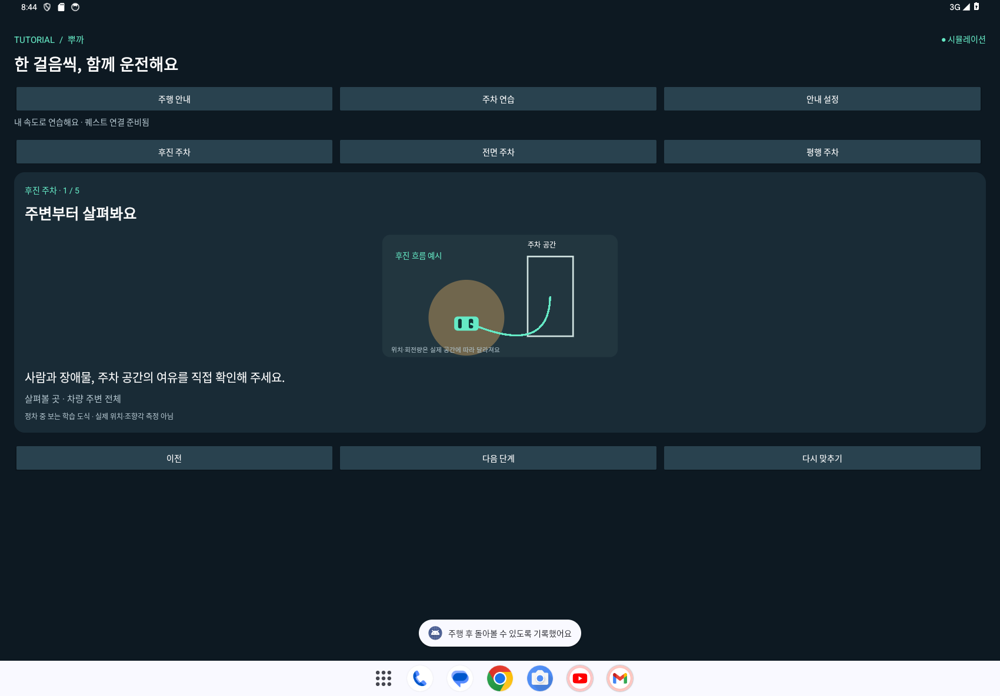

# 검증 기록 · 2026-11-12

상태: **실험 중**. 주행·주차 코치 화면과 Pleos 연동 코드를 구현했습니다. 실제 Pleos 서비스 값 수신은 아직 검증 완료가 아닙니다.

후속 확인: 실제 콜백 관측/엄격한 검증 기준을 추가한 최신 소스에서도 앱·테스트 APK 빌드, 단위 테스트 26개(실패 0), Lint를 통과했습니다. Pleos 실제 값 수신 성공은 아니며, 집 PC 재개를 위해 [이관 컨텍스트](HANDOFF.txt)에 최신 환경 오류와 실행 순서를 기록했습니다.

## 통과한 확인

- `assembleDebug`, `assembleDebugAndroidTest` 성공. Vehicle 2.3.2, NaviHelper 3.0.5, TextToSpeech 3.3.1 공개 API로 컴파일했습니다.
- `testDebugUnitTest`: 코치 21개 + 기존 속도 2개 = **23개, 실패 0**.
- `lintDebug`: **오류 0, 경고 22**. 경고에는 기존 대상 SDK/아이콘 설정과 텍스트 국제화 항목 등이 있습니다. SDK 버전과 기존 MainActivity는 변경하지 않았습니다.
- API 34 일반 Android 에뮬레이터(Pixel 3a)에서 `CoachSmokeRunner`: **PASS**, scenario_steps=3.
- 1080×2220 세로 화면 및 1700×1184 / 160dpi 가로 앱 영역에서 각각 PASS.
- 같은 교차로의 세 단계 → 어려움 메모 → 주차 학습 5단계 → 하차 체크 창까지 실행했습니다. JSON 이벤트 왕복·커서 재조회와 메모 분류도 확인했습니다.
- 캡처를 열어 글자·버튼·교차로 강조와 주차 도식, 체크 창을 확인했습니다. 테스트의 마지막 추가 변경은 호스트/검증용 연결 진단 조회 메서드이며, 최종 소스의 전체 빌드·단위 테스트·Lint도 성공했습니다.

처음 일반 에뮬레이터가 부팅될 때 `System UI isn't responding` 창으로 첫 캡처가 실패했습니다. 앱 ANR가 아닌 시스템 UI 창임을 확인하고 `Wait`로 복구한 뒤 재실행은 통과했습니다. 테스트 러너도 정확히 이 시스템 UI 창만 복구하며 앱 ANR를 숨기지 않습니다.

## 테스트가 확인하는 핵심 의미

- 한 교차로의 차로 준비·우회전·이탈은 같은 `situationInstanceId`를 사용합니다.
- 내비 거리로 안내 단계를 바꾸더라도 차로 변경 완료로 기록하지 않습니다.
- 방향지시등 관측, 실제 수행 근거, 사용자 어려움 메모를 구분합니다.
- 재탐색·취소·거리 급변·데이터 만료 후 이전 큐와 근거 ID를 재사용하지 않습니다.
- 반복 화면 갱신/방향지시등 폴링은 같은 이벤트를 계속 만들지 않습니다.
- 요청 시 모드는 사용자가 설명을 요청하기 전에 안내 사용을 기록하지 않습니다.
- 정차 판단은 null·NaN·후진 속도·오래된 데이터와 UX 제한 상태를 처리합니다.
- 퀘스트·gain 소비자는 `eventId`로 중복 제거하고 `DEMO`를 실제 주행과 분리해야 합니다.

## Pleos 실행 확인의 현재 한계

로컬 `Pleos_Connect_2_1_D` AVD를 별도 포트 5574로 실행했습니다. Android 14와 `android.hardware.type.automotive`는 조회했습니다. 하지만 시스템 시작과 APK 설치가 장시간 지연되고 PC 응답이 크게 느려졌습니다. 호스트 부하를 복구하기 위해 이번 작업이 띄운 해당 에뮬레이터 프로세스만 종료했습니다. APK 설치가 완료되지 않아 **코치에서 실제 TBT/방향지시등 값, TTS 재생 콜백을 수신했다는 증거는 없습니다.**

따라서 다음은 미검증입니다.

- Pleos 에뮬레이터/차량의 실제 서비스 연결·권한 부여·유효한 차량 값 수신
- 실제 경로에서 TBT 순서와 거리 정책의 적합성, 경로 변경 콜백 순서
- Pleos 한국어 TTS의 실제 출력과 시스템 안내 간 오디오 동작
- 실제 차량 주행 상태에서 앱 표시 허용 및 UX 제한 전환
- 실제 센서 기반 차로 변경·회전·교차로 이탈 완료 판정

성능 한계를 우회하려고 차량 상태나 앱 실행 결과를 가상 값으로 꾸미지 않았습니다. 완성된 차로 변경/주차 보조 시스템으로 간주할 수는 없습니다. 현재는 공식 SDK 연결 코드와 입력 경계를 갖춘 코치 실험입니다.

## 재현

전체 빌드 명령은 [구현 문서](README.md)에 있습니다. 일반 에뮬레이터의 화면 확인:

```powershell
adb install -r app/build/outputs/apk/debug/app-debug.apk
adb install -r app/build/outputs/apk/androidTest/debug/app-debug-androidTest.apk
adb shell am instrument -w -r com.hmgchallenge.pleosstarter.test/com.hmgchallenge.pleosstarter.driving.CoachSmokeRunner
```

충분한 메모리의 Pleos 에뮬레이터에서 읽기 전용 연결 관찰:

```powershell
adb shell am instrument -w -r -e live_probe 1 com.hmgchallenge.pleosstarter.test/com.hmgchallenge.pleosstarter.driving.CoachSmokeRunner
```

`live_probe`의 PASS는 관찰 루틴이 끝났다는 뜻입니다. `sdk_status` 출력에서 내비·방향지시등·음성 각각의 실제 응답과 실패를 확인해야 합니다. 별도의 성공 판정 없이 서비스 연결 성공으로 해석하면 안 됩니다. 에뮬레이터 전용 러너는 ranchu/goldfish 또는 emulator 모델을 확인하고 실제 차량에서는 실행을 거부합니다.

## 브랜치 보존과 결과물

- 기준 main: `c683e4146dd51491227fd15e61935178b3c03a78`
- `scratch/quests` 보존: `5e577f84c6e840bcf9fbee3cce6af16a095252de`
- `scratch/gain` 확인: `fb6b4a7935cd0c64e5e710b832be5f7190e90605`. 주행 피드백 계획 + STT 검증 코드. 이 브랜치의 내용을 수정/이름 변경하지 않았습니다.
- 기존 `MainActivity.kt`는 main과 차이 없음. 브랜치에서 Manifest의 새 코치 런처/권한과 TTS 의존성만 추가했습니다.
- APK SHA-256: `75DFFED216C33E33D62D51BD4B26701A838AF03BDC78A77258B33857AAE97113`
- APK는 로컬 작업 공간 `output/driving-coach-preview/tutorial-driving-coach-debug.apk`에 복사했습니다. Git에는 개인 SDK 경로, 빌드 파일, APK를 추가하지 않습니다.




