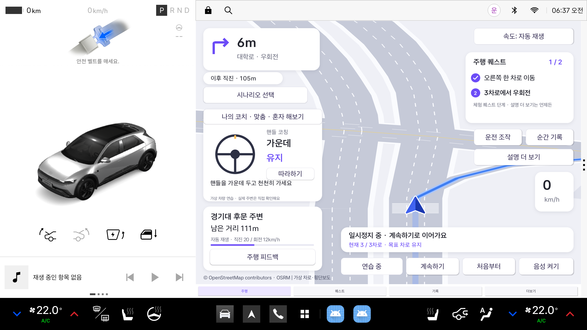
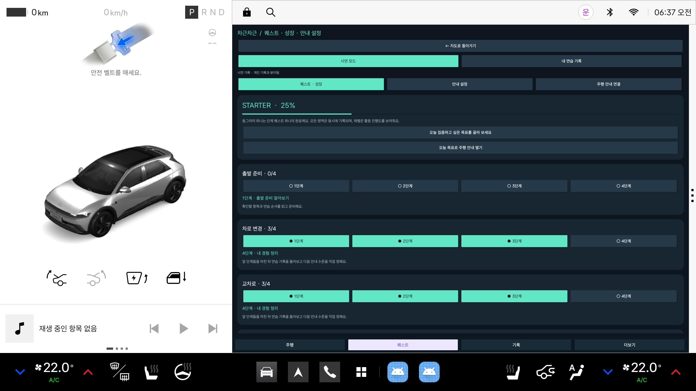
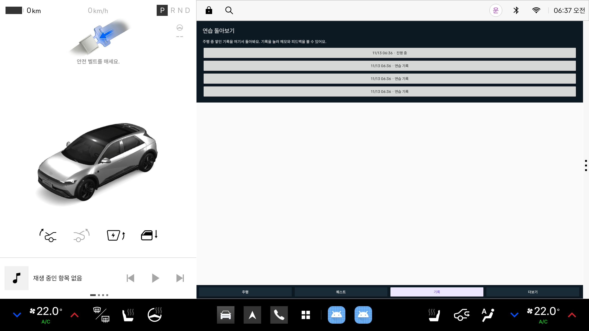

# 차근차근 통합 시연

작업 브랜치는 `integration/chageun-coach`다. 팀원 브랜치를 가져와 이 브랜치 안에서만 통합한다. 원본 main·gain·quests·Room 브랜치에 push하지 않는다.

## 어디에서 무엇을 누르나요?

앱 목록의 **차근차근** 하나를 연다. 개발용 Pleos 에뮬레이터에서는 지도 코치가 기본으로 열린다.

| 아래 탭 | 하는 일 |
| --- | --- |
| 주행 | 흰색 지도와 주행 코치로 돌아감. `연습 시작`으로 재생, `시나리오 선택`으로 차로 변경·우회전·주차 선택 |
| 퀘스트 | 누적 연습과 단계 확인. 상단 `← 지도로 돌아가기`로도 지도 복귀 |
| 기록 | 같은 DB에 저장된 주행, 기억한 순간, 피드백 확인. 새 주행을 만들지 않음 |
| 더보기 | 튜토리얼·코치 설정·직접 운전 조작·사용법 |

남색 주행 코치 화면의 `운전석 체험` 버튼은 `← 지도로 돌아가기`로 이름을 통일했다. 직접 조작판의 기존 `지도 보기` 버튼도 같은 이름이다. 화면 색과 본문 레이아웃은 유지했다.

퀘스트가 열려 있지 않아도 지도 뒤에서 완료 근거와 기록을 쌓는다. 앱 안에서 퀘스트·기록·튜토리얼로 이동하면 같은 주행이 이어진다. 앱을 벗어나면 연습을 일시정지하고 SDK 연결을 정리한다. 앱 프로세스가 종료된 뒤에도 실행하는 Android foreground service는 아니다.

음성은 지도 아래 `음성 켜기`로 켠다. 현재 맞춤 모드가 ‘혼자 해보기’라면 추가 코치 설명은 요청할 때만 제공한다. `설명 더 보기`, `순간 기록 → 이 상황이 어려웠어요`를 통해 도움을 다시 받을 수 있다.

## 시연을 초기화하고 성장 보기

`퀘스트 → 시연 모드`의 맨 위 카드에서 `시연 진행 초기화 → 처음부터 보기`를 누른다. 체험 단계·횟수와 이전 어려움에 따른 도움 복원을 새로 시작한다. 이전 수행 근거는 보관하여 지난 주행·메모·피드백을 다시 열어도 유지하며, 개인 기록은 변경하지 않는다.

`준비 확인하고 지도에서 연습`을 누르면 차로 변경·교차로의 준비 단계가 채워진다. 지도에서 연습을 1회 완료하면 두 영역이 각각 2/4단계, 누적 3회면 3/4단계가 된다. 4단계는 해당 영역에서 직접 경험을 돌아보고 한 문장을 남겨 완료한다. 이는 가속한 시연 규칙이며 실차 운전 실력의 승급 판정이 아니다.

완료 후 `퀘스트`에서 횟수·단계를 확인하고, `기록 → 방금 연습 기록`에서 같은 주행의 잘한 점·다음 연습·메모를 본다. 지도 `주행 피드백`에서도 이번 연습 결과를 열 수 있다.

## 통합 내용과 범위

- gain의 AAOS 속도 수신과 STT 실험 코드, Room 원형, quests의 단계 엔진과 주행 코치를 병합했다.
- 주행 시작·속도·상황·메모·퀘스트 근거·리포트를 한 Room DB와 tripId로 연결했다. 메모에는 당시 가상 위치와 안내 문구도 함께 남긴다.
- 시나리오 성공은 체험 프로필에만 저장한다. 실제 차량 속도로 재생해도 실제 차로 변경·주차 성공으로 판정하지 않는다.
- 실제 주행 중 퀘스트·기록·학습 화면의 정차 제한은 유지한다.
- 휴대폰 앱·계정·서버 동기화, 실제 운전의 여러 날·성공률 승급, 8개 기술 전체의 차량 판정은 후속 범위다. STT 실제 인식 성공은 미검증이며, 글로 메모하는 경로는 동작한다.

## 확인한 화면

아래는 사용자 DB와 분리된 검사 기록으로 촬영한 에뮬레이터 화면이다.

[DB 연결 구조](shared-data.md) · [Figma·Notion·문서 검토](source-review-2026-11-13.md) · [개발 계획 5번](../development-plan-ko.md)
