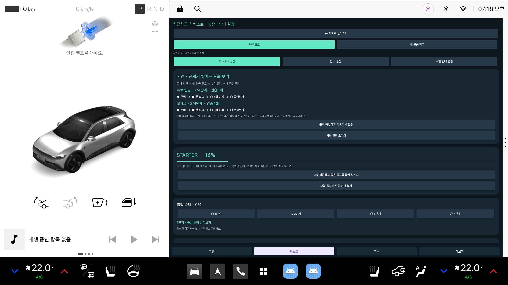
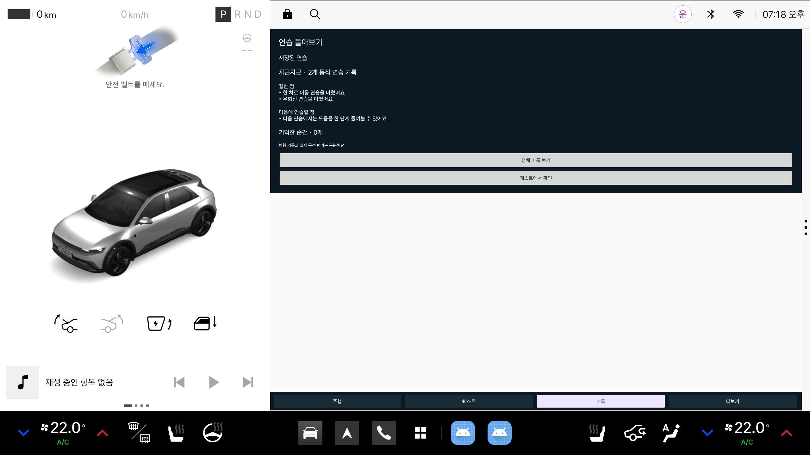

# 통합 검증 · 2026-11-13

대상: `integration/chageun-coach`, Pleos Connect 2.1 Android 14 에뮬레이터, `emulator-5574`, Android user 10, JDK 17. 테스트는 사용자 `trips.db`와 분리된 in-memory DB 및 고정된 테스트 전용 migration DB를 사용한다. 생성한 모든 테스트 화면을 닫은 뒤 DB를 정리한다.

| 검사 | 결과 |
| --- | --- |
| Debug APK·AndroidTest APK 빌드 | 통과 |
| 단위 테스트 | 105개, 실패 0 |
| Lint | 오류 0, 경고 87 |
| 공통 DB + 화면 이동 (`database_probe`) | `PASS_SHARED_DATABASE` |
| 핸들 직접 조작·성공음·주차 (`interaction_probe`) | `PASS_COACH_INTERACTION` |
| 실제 SDK 속도·외부 콘솔 소유권·조명 복원 (`navigation_probe`) | `PASS_FIGMA_NAVIGATION` |

## 공통 DB·화면 이동 확인

- 하나의 tripId로 상황 이벤트·1Hz 속도 샘플·메모·퀘스트 근거·리포트 조회.
- 같은 완료 근거 재저장 시 중복 가산하지 않음. 개인 프로필은 변경되지 않음.
- 단계에 따른 상세/힌트/요청 시 코치 선택. 어려움 기록 후 상세 도움 복원, 누적 단계 유지.
- 메모의 당시 가상 위치와 안내 문구 저장. 새 연습의 메모가 이전 주행에 붙지 않음.
- 기존 Room v1의 6개 테이블 데이터를 보존하며 v2 이관. DB 재개방 후 퀘스트·메모 유지.
- 공통 탭으로 지도 → 퀘스트 → 지도 → 기록 → 튜토리얼 → 지도 왕복.
- 퀘스트가 앞에 표시된 동안 동일한 주행의 이동과 샘플 저장 지속.
- 다른 앱으로 이동 시 실행·SDK 중지, 돌아오면 동일한 연습이 일시정지 상태로 유지.

가속한 시나리오 검사는 가상 시간을 사용했다고 증거 JSON에 표시한다. 속도 샘플 저장과 앱 전환은 실제 시간으로 검사했다. 위 결과는 실차 운전 실력·차로 성공·교통신호 인식의 검증이 아니다.

## 핸들·주차 확인

앱 런처는 차근차근 하나다. 잘못된 방향의 핸들 입력은 성공 처리하지 않으며, 직접 목표를 맞추고 유지했을 때만 띵동을 한 번 재생한다. 핸들 따라하기만으로 주행 퀘스트를 가산하지 않는다. 가상 연습장의 후진 주차가 완료되고 주차 근거만 추가되는 것을 확인했다.

주행 퀘스트의 큰 축하음·조명은 가상 주행 종료 후로 미뤘다. 진행 중 차로 변경마다 큰 축하 멜로디를 반복하는 방식은 사용하지 않는다. 실제 조명 제어는 지원·권한·실제 P단·최신 정지 속도를 모두 확인하고 원래 색으로 복원한다.

## 실제 SDK 연결 확인

`navigation_probe`는 차로 변경·우회전과 후진 주차 재생에 가상 시간을 사용했다. 실제 SDK 속도 구간은 가속하지 않고 외부 Virtual Console의 20km/h(약 5.56m/s)를 수신해 실제 경과 시간과 이동 거리를 비교했다. 앱이 외부 콘솔의 속도를 덮어쓰지 않는 것과, 지원되는 실내 조명을 민트색으로 요청한 뒤 원래 값으로 복원하는 응답을 확인했다. 테스트 증거에는 재생의 가상 시간 여부와 SDK 구간의 실제 시간 여부를 각각 표시한다.

차량 SDK의 최초 지원 조회는 내부 reflection 비용 때문에 화면을 멈출 수 있어, 초기화·지원 조회·해제를 순서가 보장되는 별도 실행기로 옮겼다. 화면 상태 반영은 메인 스레드에서 처리한다. 에뮬레이터의 차량·오디오 서비스 응답 지연은 실차 성능 검증을 대신하지 않는다.

## 남은 검증

### 2026-11-14 시연 초기화 추가 검사

빌드·105개 단위 테스트·Lint(오류 0, 경고 87)를 다시 통과했다. `database_probe`에서 체험 횟수·단계·예전 어려움의 도움 복원을 초기화하고, 기존 주행의 샘플·메모·수행 근거·피드백과 개인 프로필은 보존되는 것을 확인했다. 이전 수행 근거는 보관 프로필로 옮기며 지난 피드백은 tripId로 해당 근거를 조회한다. 프로필 초기화와 보관은 한 DB 트랜잭션이다.

별도로 실제 앱의 영구 `trips.db`에서 초기화 → 준비 확인 → 실제 시간으로 자동 연습 완료를 실행했다. 차로 변경·교차로가 각각 2/4단계·1회, 전체 16%로 갱신되고 기록 화면에 같은 두 동작의 피드백이 표시됐다. 앱을 강제 종료한 뒤 DB와 WAL을 복사하여 SQLite로 직접 조회했다. 주행 `e7bc81a3-7f95-4083-bf99-cf54da2f21cb`의 종료 상태 COMPLETE, 약 192m, 속도 샘플 47개, SIMULATION 수행 근거 2개, 동일 tripId의 피드백과 `integrity_check=ok`를 확인했다. 개인 프로필은 실행 전 DB와 같았다. 원시 DB는 Git에 포함하지 않는다.

STT는 가인의 코드를 통합하고 콜백 컴파일 오류를 수정했다. 인식된 내용의 편집·저장 경로와 글 입력 대체는 구현했으나 **실제 발화를 인식했다는 검증 결과는 없다**. 음성 명령 전체, 모바일 동기화, 프로세스 종료 후의 지속 수집 서비스, 실차 주행 승급은 별도 범위다.

원시 검증 로그와 JSON, APK는 로컬 `output/integration-2026-11-13` 및 `tmp/home-runtime`에 보관한다. 공유용 화면은 [images](images/)에 포함했다.
