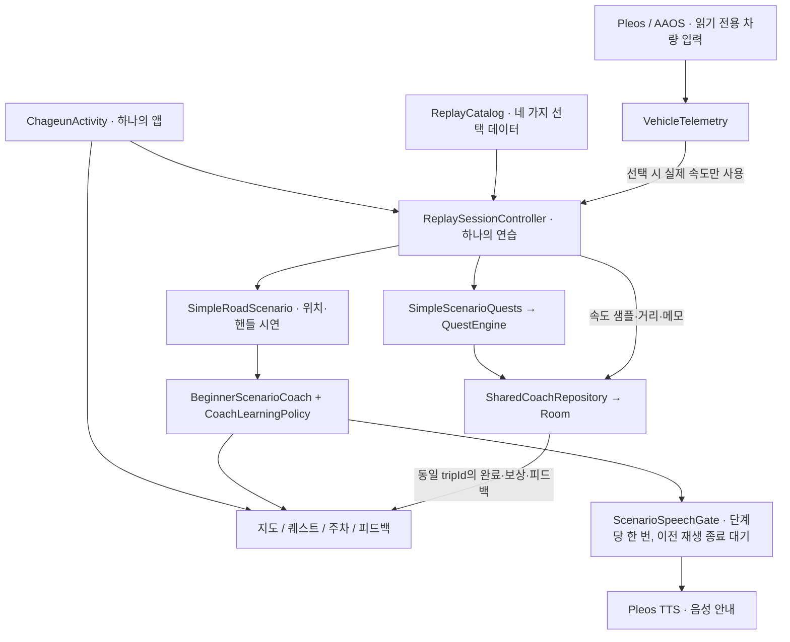
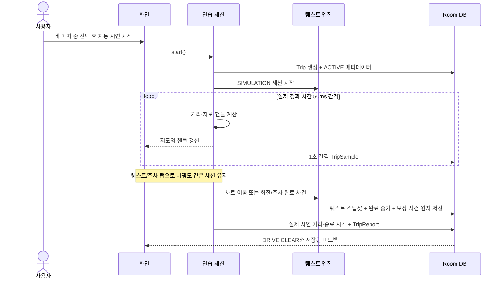
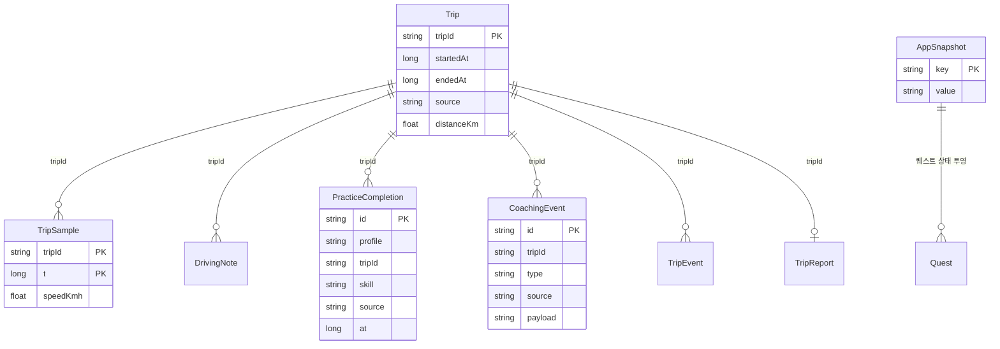

# 차근차근: 코드와 데이터 흐름

이 문서는 `refactor/chageun-product-ui`의 실제 실행 경로를 설명한다. 기존 실험 문서는 과거 구현 기록이며 현재 런처는 `app.ChageunActivity` 하나다.

## 읽는 순서

| 위치 | 책임 | 하지 않는 일 |
| --- | --- | --- |
| `app/ChageunActivity.kt` | 앱 수명주기, 네 화면 전환, 사용자 명령, 음성 연결 | 차량 페달/기어 제어 |
| `ui/*Canvas.kt`, `ProductScene.kt` | 상태를 그림·버튼으로 표시 | 퀘스트 성공 판정·DB 직접 변경 |
| `ui/SteeringWheelRenderer.kt` | 이전 코칭 핸들의 회전·직진 기준·복원 표시 | 조향 센서 측정이나 실제 차량 조향 |
| `session/ReplayCatalog.kt` | 선택 가능한 네 시연 정의와 기대 결과 | 시작 전 기록/점수 생성 |
| `session/ReplaySessionController.kt` | 하나의 연습, 일시정지, 샘플 기록, 퀘스트 동기화, 마무리 | 화면별 Activity 생성 |
| `session/VehicleTelemetry.kt` | 실제 속도·깜빡이·내비 SDK 읽기 | Virtual Console 쓰기, 신호만 보고 성공 판정 |
| `driving/SimpleRoadScenario.kt` | 경로상의 거리·차로·핸들 시연 상태 계산 | 실제 GPS/차로 인식 |
| `driving/BeginnerScenarioCoach.kt`, `CoachLearningPolicy.kt` | 자연스러운 핸들 표현, 연습 단계·어려움에 따른 도움 정도 | 임의 실력 점수 |
| `driving/ScenarioCoachingCues.kt` | 행동 단계별 고정 문구·한 번만 발화·최소 간격·재생 종료 대기 | 곡률 변화마다 말하거나 지난 안내를 대기열에 쌓기 |
| `driving/SimpleScenarioQuests.kt`, `quests/QuestEngine.kt` | 명시적인 시연 완료 사건을 중복 없이 처리 | 속도/깜빡이를 완료 증거로 간주 |
| `core/data/SharedCoachRepository.kt` | 같은 Room DB에 주행·메모·퀘스트·보상·피드백 저장 | 클라우드 동기화 |

## 전체 구조

차량 SDK의 값과 시연 값은 별개다. 실제 속도를 선택해도 지도 위치·차로·핸들은 준비된 경로에서 계산한 시연 값이며, 모든 완료 증거는 `SIMULATION`/`demo`에만 쌓인다. `personal`의 실력 기록으로 승격하지 않는다.

핸들 그림은 축간거리 2.7m/조향비 14.5를 가정한 시연 모델이다. 조향량과 회전·복원 흐름은 같은 경로를 기준으로 계산한다. SteeringCoachingTimeline은 더 돌리기, 유지, 반대 방향으로 풀기, 가운데 유지 구간을 생성한다. 새 조향 구간마다 음성 안내를 다시 허용한다. 같은 구간은 한 번 안내하고, 이전 음성이 끝난 후 현재 구간의 짧은 문장을 읽는다. 주차 화면에서는 방향을 포함한 자세한 설명을 표시한다. 핸들 화살표는 제거했다. 실제 차량별 조향 보정과 사용자 반응 시간 검증이 필요하다.

## 시작부터 완료까지

앱 밖으로 나가면 연습은 일시정지하고 SDK·음성을 해제한다. 앱 안의 탭 이동은 연습을 중단하지 않는다. 프로세스가 예고 없이 종료된 경우 이 런타임의 ACTIVE 기록을 다음 실행에서 INTERRUPTED로 마감하며 완료/보상을 새로 만들지 않는다.

## 데이터 구조

그림의 연결은 코드의 논리적 연결이며 기존 스키마에 새 SQL 외래키를 추가한 것은 아니다. `TripSample`은 `(tripId,t)` 복합키다. JSON 메타데이터에는 lesson/profile/speedSource/scenario/runtime/status가 들어간다. 개인 식별·계정·서버 DB는 아직 없다.

보상은 새 테이블 대신 기존 `CoachingEvent`의 `PRACTICE_REWARD`로 저장한다. ID는 `완료증거ID:reward`라 재호출에도 한 번만 들어간다. 차로 변경 200P, 교차로 100P, 주차 100P이며 미지원 퀘스트는 0P다. 현재 포인트는 해당 프로필의 완료 증거와 연결된 보상만 합산한다. 초기화는 기존 demo 증거를 아카이브하므로 현재 포인트가 0이 되어도 지난 주행의 보상/피드백은 보존된다.

## 남긴 것과 제거한 것

- 남김: 기존 코칭 핸들 렌더링, 네 자동 시연, 오프라인 OSM 경로, 퀘스트 단계 엔진, 실제 속도·깜빡이·내비 읽기, Pleos TTS/STT 어댑터, 메모, 정차/P단/지원 여부 확인 후 복원하는 앰비언트 응원, 기존 Room v1→v2 마이그레이션.
- 제거: 페달 유지/해제, 기어·벨트·창문·와이퍼 버튼, 수동 주행 물리, 별도 운전석 화면, HTTP Virtual Console 조작/하트비트, 흰색·남색 화면 사이 여러 Activity 전환.
- 기존 `CoachEngine`/계약/매퍼는 실제 입력 검증과 팀 브랜치 연계에 쓰는 순수 정책으로 유지한다. 현재 자동 시연은 이 엔진의 과거 버튼 체험 경로를 실행하지 않는다.

## 실제 서비스로 이어갈 항목

실제 경로 공급·차로/조향 검증 생산자, 실제 차량 코칭 세션과 personal 증거 연결, AAOS 주행 중 UX 승인, 백그라운드 서비스/재연결, 계정·서버 동기화, 다양한 해상도/접근성 검증이 필요하다. 현재 화면을 실제 주행 지원 승인이나 정확한 조향 지시로 설명하지 않는다. Debug의 주행 중 표시 메타데이터는 에뮬레이터 검사용이며 물리 차량에서는 이 Debug 진입을 거절한다. Release는 해당 메타데이터를 넣지 않는다.
